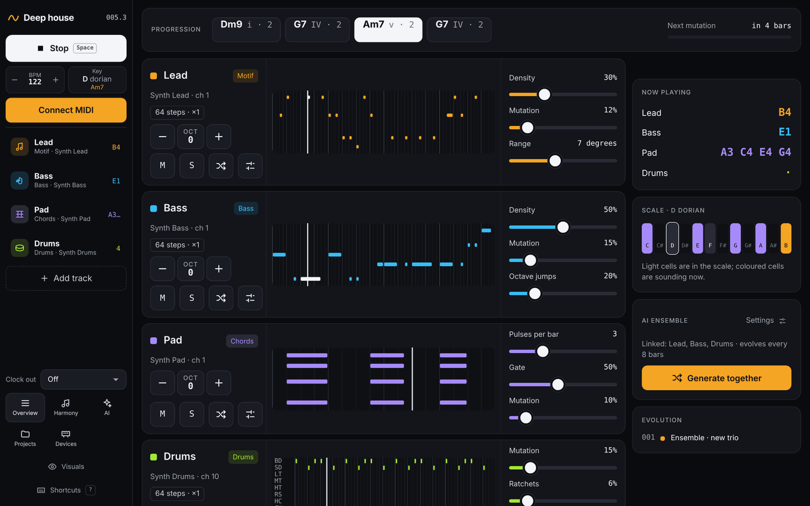

# Drift

**A generative MIDI sequencer that runs in your browser.** Drift plays
evolving lead lines, bass, chords, arpeggios, drones and drums on your
synths over USB MIDI. Every track stays in the same key and on the same
chord, and keeps changing a little, so you can keep your hands on the
knobs instead of the mouse.

- **Plays your hardware.** Any USB MIDI synth or drum machine, with MIDI
  clock out (e.g. to a Roland TR-8S). No synths at hand? The built-in
  *Drift Synth* sounds play right away.
- **Music that evolves.** Each track mutates every few bars, remembers its
  theme, and can listen to the other tracks: making room for them or
  answering them.
- **One harmony for everything.** Pick a key and a chord progression, or
  let Drift write and evolve one. Every track follows it.
- **AI ensemble.** Magenta's MusicVAE writes melody, bass and drums that
  belong together, and drifts through variations while you play. It has its
  own page, with settings for fit, busyness and evolution.
- **No account, no backend.** A web app that works offline once installed
  (apart from the AI ensemble).
  Projects are saved in your browser.

## Open Drift

- **In the browser:** [birgerj.github.io/drift-sequencer](https://birgerj.github.io/drift-sequencer/).
  Use Chrome or Edge for hardware MIDI.
- **As an app:** choose *Install app* in Drift's left bar, or the install
  icon in Chrome's address bar.
- **As one file:** download [`standalone/index.html`](standalone/index.html)
  and double-click it. No install needed; only the AI ensemble needs the
  internet.

## Manual

The full manual, with screenshots, is in **[docs/](docs/README.md)**:
[getting started](docs/01-getting-started.md),
[the performance screen](docs/02-performance.md),
[tracks](docs/03-tracks.md),
[harmony](docs/04-harmony.md),
[playing together](docs/05-playing-together.md),
[the AI ensemble](docs/06-ensemble.md),
[sound and modulation](docs/07-sound-and-modulation.md),
[devices](docs/08-devices.md),
[projects](docs/09-projects.md),
[keyboard shortcuts](docs/10-shortcuts.md) and
[development](docs/11-development.md).
