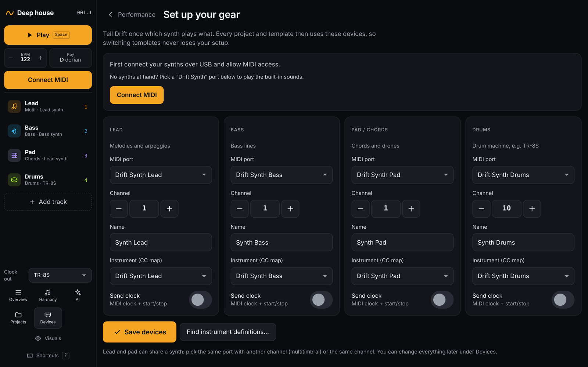

# Getting started

[Manual](README.md) · Next: [The performance screen →](02-performance.md)

## What you need

- **A browser with Web MIDI** for hardware: Chrome or Edge on a computer.
  Safari and iOS have no Web MIDI; there you can still play the built-in
  *Drift Synth* sounds.
- **Synths or a drum machine** connected over USB MIDI (or a USB MIDI
  interface). Every port of a multi-port interface shows up as its own
  output with 16 channels.
- Nothing else: no account and no server. Projects are stored in your
  browser.

## Open Drift

| How | When to use it |
| --- | --- |
| [birgerj.github.io/drift-sequencer](https://birgerj.github.io/drift-sequencer/) | Quickest start. |
| **Install app** in the left bar (or the install icon in Chrome's address bar) | Drift in its own window. It starts without internet once installed and updates itself; when a new version is ready you'll see *A new version of Drift is ready* with a **Reload** button. |
| Download [`standalone/index.html`](../standalone/index.html) and double-click it | Nothing to install: the whole app is in that one file. It plays offline; only the AI ensemble (and the fonts of some themes) need the internet. |

## Connect your synths

1. Connect your synths over USB and switch them on.
2. Click **Connect MIDI** in the left bar and allow MIDI access. Next time
   Drift reconnects by itself.
3. Click **Set up devices** in the banner on the performance screen. You
   can also get there later from **Devices → Setup wizard**.

The setup page has a card for each role: **Lead** (melodies and
arpeggios), **Bass**, **Pad / chords** (chords and drones) and **Drums**.
For each one:

- Pick the **MIDI port**. Drift guesses ports for you where it can.
- Set the **Channel**: 1 by default, 10 for drums.
- Optionally give it a **Name** and choose its **Instrument (CC map)**, so
  Drift knows its knobs. See [Devices](08-devices.md).
- Turn on **Send clock** for the device that should follow Drift's tempo,
  usually the drum machine. Here you pick one; under
  [Devices](08-devices.md) several devices can receive clock.

Then click **Save devices**. Every project and template uses these
devices, so switching templates never loses your setup. Lead and pad can
share one synth: pick the same port with another channel (multitimbral),
or the same channel.

> **No synths at hand?** Pick the *Drift Synth Lead*, *Bass*, *Pad* and
> *Drums* ports. They are sounds built into Drift and play through your
> computer's speakers.

## Play

Press **Play** (or `Space`). The first time, Drift opens the *Deep house*
template: a lead, a bass line, a pad and drums in D dorian. After that it
reopens your last project. Things to try:

- Watch the lanes: every few bars a track mutates. The **Evolution** card
  on the right lists what changed.
- Click the dice on a lane for a new pattern, or **M** and **S** to mute
  and solo.
- Open **Projects** in the left bar and try another template, such as
  *Acid* or *Conversation*.
- Open **Harmony** and click **New progression**.
- Open **AI** and let the model write a trio (press `G`).

Next: [The performance screen →](02-performance.md)
