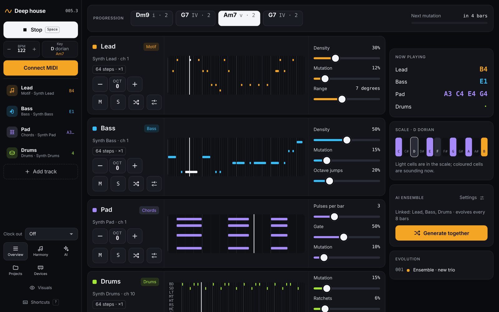

# The performance screen

[← Getting started](01-getting-started.md) · [Manual](README.md) · Next: [Tracks →](03-tracks.md)

This is the screen you play from. Open it any time with **Overview** in the
left bar, or press `O`.

## The left bar

The left bar is always there, on every screen.

- **Project name**: opens [Projects](09-projects.md). Next to it is the
  position, shown as bar and beat (`005.3`).
- **Play / Stop** (`Space`).
- **BPM**: − and + change the tempo (20–300). The keys `,` and `.` change
  it by 1, or by 5 with Shift.
- **Key**: the key and mode, plus the chord playing now. Click it to open
  [Harmony](04-harmony.md).
- **Connect MIDI**: shown until MIDI is connected.
- **Track list**: every track with its type and device. On the right you
  see the notes it plays right now, or its number: press `1`–`9` to jump
  to that track. Muted tracks are dimmed. **+ Add track** adds a new
  Motif track and opens it.
- **Clock out**: which device receives MIDI clock and start/stop, or *Off*.
- **Overview**, **Harmony**, **Projects**, **Devices**: the main
  screens.
- **Visuals** opens the visuals window (see below). **Shortcuts** shows
  the [keyboard shortcuts](10-shortcuts.md).

## Progression

The strip at the top shows the chord progression: each chord with its
roman numeral and length in bars. The chord playing now lights up. Click a
chord to edit the progression in [Harmony](04-harmony.md).

**Next mutation** counts down to the next bar where a track changes.

## Lanes

Every track has a lane:

- **Name**: opens the [track editor](03-tracks.md). Next to it is the
  track type, and below it the device and channel. The port turns into a
  warning when it isn't connected.
- **Badges** show non-default settings: pattern length and speed (for
  example *64 steps · ×1*), a call-and-response role, or which tracks it
  listens to (*↔ Lead*). See [Playing together](05-playing-together.md).
- **Octave**: − and + shift the whole track by octaves.
- **M**, **S**: mute and solo.
- **Dice**: a new pattern. **Sliders**: open the track editor.
- **Pattern view**: the pattern with a moving playhead. Melodic notes are
  drawn by pitch; drum lanes show one row per voice.
- **Quick knobs**: the first three settings of the track type, such as
  *Density* and *Mutation*.

A lane dims while its call-and-response phrase is resting.

## The right column

- **Now playing**: the notes each track plays at this moment.
- **Scale**: a 12-note keyboard. Light keys are in the scale; coloured
  keys are sounding now.
- **Evolution**: the last changes, by bar: *pattern mutated*, *back to the
  theme* and so on.

## Visuals

**Visuals** in the left bar opens a separate window with full-screen
graphics that react to the music: kick, snare and hats, bass and lead
energy, and the colour of the chord. Put it on a second screen or a
projector.

- Scenes: Flyover, City, Coast, Synthwave, Warp, Tunnel, Sorter, Kaleido
  and Pulse. Press `1`–`9` to switch.
- **Speed** (`[` `]`), **Notes** (`N`), **Strobe** (`S`) and **Auto**
  (`A`, a new scene every 32 bars).
- **Fullscreen** (`F`).
- In **Flyover**, **City**, **Coast** and **Sorter**: time of day (`T`): *Dusk*
  (golden hour), *Night*, or *Dusk ↔ Night*, which slowly turns from one
  to the other and back. In Sorter the button reads *Day*, *Night* and
  *Day ↔ Night*.
- **City** is a realistic city at night after the rain: you glide down
  wet boulevards through a street grid with traffic in both directions,
  street lamps, lit windows and shopfronts, and turn left or right at the
  next intersection every 16 bars.
- **Tunnel** is a realistic motorway tunnel: two lanes each way, traffic
  in both directions and ceiling lights in the colours of the chord. A
  light pulse runs ahead of you on every beat, kick and snare make the
  lights flare, and lead and pad notes light up a stretch of ceiling
  ahead in the track's colour (higher notes further away).
- **Warp** is a journey through space. You cruise towards a planet with
  its moons (Saturn, an ocean world, a desert planet, an ice giant) while
  comets, ships and shooting stars pass by; at the end of every 16 bars
  you jump through hyperspace to the next system. Stars pulse on the
  kick, the nebula takes the chord colours, and lead and pad notes become
  shooting stars in the track's colour.

- **Sorter** is a parcel hub. Four infeeds, two low and two high, run
  through scan tunnels and merge onto an endless tilt-tray loop. Parcels
  are tipped into chutes and roll cages, go up a lift into a high-bay
  store and come back out later, or slide down to pickup stations where
  sort robots take them: each robot drives its own route over a floor
  grid of one-way lanes to its bin in rows of open cardboard bins, tips
  the parcel in, and waits on a parking spot for its next job. Flow
  projectors hang over the chute ends, the pickup stations and a manual
  sort table, and mark each parcel they handle. Forklifts drive around.
  Everything runs on the beat: belts move two metres per beat; inductions,
  diverts and scans land exactly on beats; robots drive one cell per beat
  and unload on the snare beats. Lead notes feed a parcel in the track's
  colour (high notes on the high infeeds), bass notes move the lift, pad
  notes call a parcel back from the store and tint the lights. Camera:
  *Auto* (switches every 8 bars), *Fly* or *Follow* a parcel (also on its
  robot ride), and *Next parcel*.
  The time-of-day button switches between two looks. **Day** is clean
  production: a light hall drawn like a product illustration, equipment
  in black outlines, teal sorter, roll cages and store, orange scan
  tunnels, red-footed columns, people at work and hanging signs, the
  projectors showing only their working beam, the followed parcel
  outlined in blue. **Night** is a secret party: moving heads, a mirror
  ball, haze, the projectors turned into a laser show (a new figure every
  bar, flickering with the hats), robots glowing underneath on the kick,
  and parked robots dancing on the beat. *Day ↔ Night* crossfades between
  them every few minutes.

In most scenes **Notes** shows notes as particles. In **Flyover**,
**City** and **Coast** they happen in the world instead, in the track's
colour:

| | Flyover | City | Coast |
|---|---|---|---|
| Lead (motif, arp) | A tree lights up and a lantern rises from it | A neon sign switches on along the street | A boat lights up at sea; the lighthouse takes the colour |
| Bass (bass, acid) | A shock wave rolls over the land and bends the trees | A car comes down the oncoming lane | A wave crashes against the cliffs |
| Pad (chords, drone) | A glow spreads over the fields | A searchlight sweeps the sky | Sun or moon rays break through onto the water |
| Drums | Trees sway on the bar, kicks are gusts, snares light the clouds | Street lamps pulse on the kick, snares make the neon flicker | The lighthouse turns once per bar, grass sways, kicks lift the swell, snares are lightning in the rain shower, hats glint on the water |

The controls hide after a few seconds. Visuals need WebGL 2; without it
only *Pulse* works.

Next: [Tracks →](03-tracks.md)
