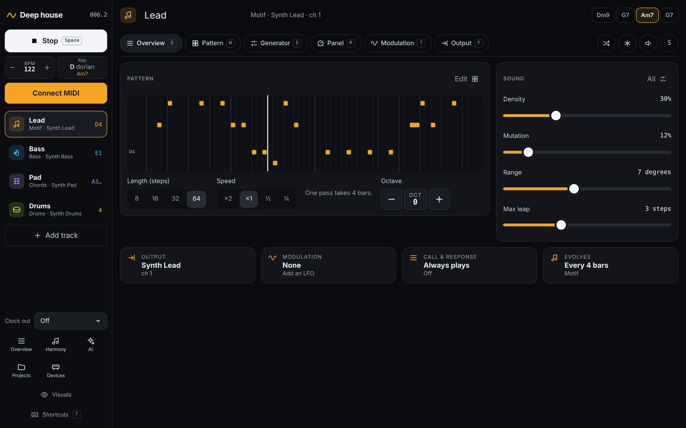
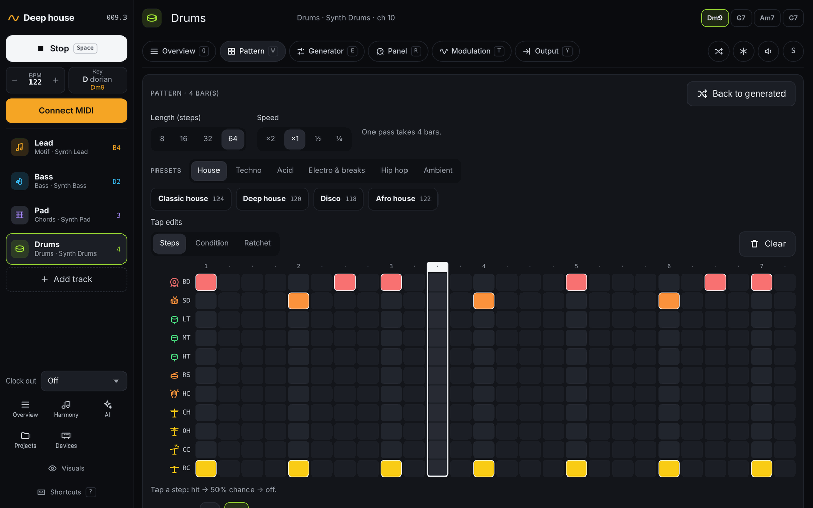
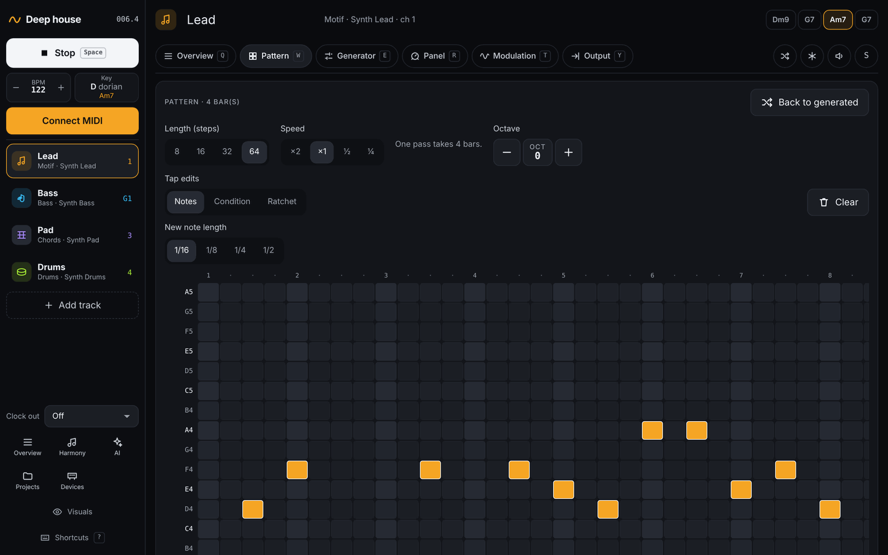
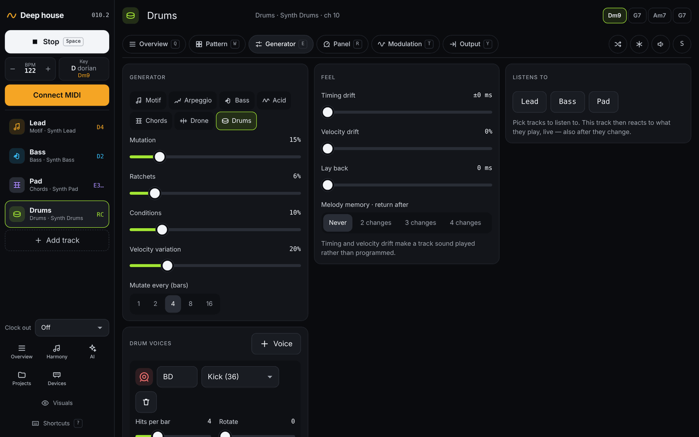

# Tracks

[← The performance screen](02-performance.md) · [Manual](README.md) · Next: [Harmony →](04-harmony.md)

A track is one part (a lead, a bass line, drums) played by a *generator*
on one of your devices. Open a track by clicking its name on the
performance screen, or press its number (`1`–`9`).

## Track types

| Type | What it plays | Main settings |
| --- | --- | --- |
| **Motif** | A short theme that slowly mutates. | Density, Mutation, Melody style (*Phrases* or *Random walk*), Range, Max leap, Chord-tone pull, Rhythm lock, Velocity |
| **Arpeggio** | Breaks up the current chord. | Direction (Up, Down, Up-down, Random), Octaves, Rests, Rate (1/16, 1/8, 1/4), Gate |
| **Bass** | Root, fifth and octave. | Density, Octave jumps, Fifths, Offbeat (house-style offbeat eighths) |
| **Acid** | 303 lines with accent, slide and octaves. | Accents, Slides, Density, Octave up/down, Note variety, Gate |
| **Chords** | Voice-led chords of the progression. | Style (*Sustain* or *Pulse*), Pulses per bar, Gate |
| **Drone** | Long notes on the root. | Follows (*Key root* or *Chord root*) |
| **Drums** | Euclidean voices with step chance. | Mutation, Ratchets, Conditions, plus a card per drum voice |

Most types also have **Velocity variation**. Melodic tracks never store fixed notes. They store notes *relative to the
harmony*, so a melody keeps its shape while following the chords. See
[Harmony](04-harmony.md).

## The track editor

The header shows the track name (click it to rename) and the chord
progression. Six tabs, each with a key:

| Tab | Key | What's on it |
| --- | --- | --- |
| **Overview** | `Q` | The pattern, its length and speed, the main knobs, and a summary of output, modulation, call and response, and how the track evolves. |
| **Pattern** | `W` | Draw and edit the pattern; drum presets; variations. |
| **Generator** | `E` | Track type and all its settings, Feel, Listens to, drum voices. |
| **Panel** | `R` | The synth's knobs. See [Sound and modulation](07-sound-and-modulation.md). |
| **Modulation** | `T` | LFOs, recorded motions, and call and response. |
| **Output** | `Y` | Which device the track plays on; **Delete track**. |

Buttons on the right of the tabs:

- **Dice**: a new pattern (`N`).
- **Snowflake**: freeze or unfreeze (`F`).
- **Speaker**: mute (`M`).
- **S**: solo (`S`).

## Length, speed and octave

On the *Overview* and *Pattern* tabs:

- **Length (steps)**: 8, 16, 32 or 64 sixteenth notes (`←` `→`). A
  longer pattern repeats the current one; a shorter one cuts it.
- **Speed**: ×2, ×1, ½ or ¼ (`Shift+←` `Shift+→`). Slow speeds suit
  chords and drones; ×2 makes fast runs and arps. The hint shows how long
  one pass takes.
- **Octave**: −3 to +3 (`[` `]`). Tap the number to reset it to 0. Not
  for drums.

## Evolution and freeze

Every track mutates every few bars: part of the pattern changes, the rest
stays, so the music evolves without losing its identity.

- **Mutate every (bars)**, on the *Generator* tab, sets how often: 1, 2,
  4, 8 or 16 bars.
- **Freeze** stops a track from changing. Frozen tracks keep their
  pattern until you unfreeze them.
- **Variations** (on the *Pattern* tab) shows the last ten patterns,
  named after their place in the track's history (*A*, *A1*, *A2*…). Tap
  one to go back to it. Variations only last until you reload the page.

## Drawing patterns

The *Pattern* tab has an editor for **Drums**, **Motif** and **Acid**
tracks. Other types show the pattern read-only. **Any edit freezes the
track**, so your edit isn't mutated away. Unfreeze it to let it evolve
from there. **Back to generated** throws your edit away; **Clear** empties
the pattern.

### Drums

- Tap a step: **hit → 50% chance → off**. Softer hits are drawn darker.
- Tap a voice name to mute that voice.
- **Tap edits: Condition** turns taps into Elektron-style *trig
  conditions*: 1:2 plays on the 1st of every 2 passes, 3:4 on the 3rd of
  every 4, and so on.
- **Tap edits: Ratchet** repeats a hit 2, 3 or 4 times within its step.
- **Presets** give one-tap grooves for the TR-8S, by genre: House (Classic
  house, Deep house, Disco, Afro house), Techno (Driving techno, Minimal,
  Hard techno rumble, Tribal toms), Acid (Acid 909), Electro & breaks
  (Electro, Funky break, UK garage 2-step, Drum & bass), Hip hop (Boom
  bap, Trap (half time), Dembow) and Ambient (Sparse pulse). A preset
  replaces the pattern and the drum voices, and freezes the track. It
  suggests a tempo but doesn't change it.

### Motif

- Rows are scale degrees counted from the current chord. Highlighted rows
  are chord tones. Because notes are relative, your melody follows the
  progression.
- Tap an empty cell to add a note of the **New note length** (1/16, 1/8,
  1/4 or 1/2). Tap a note to remove it, or tap its tail to shorten it.
- **Condition** and **Ratchet** work as for drums, on the start of a note.

### Acid

One note or rest per step, from eight scale degrees (root to octave). Tap
a cell to set the note, and tap it again for a rest. The rows below toggle
**Oct ▲**, **Oct ▼**, **Accent** and **Slide** per step. A slide needs a
note on the step before it.

## Drum voices

Drum tracks have a **Drum voices** card on the *Generator* tab. Each
voice is a euclidean rhythm:

- **Hits per bar** (0–16), spread as evenly as possible over the bar.
- **Rotate** (0–15) shifts the rhythm.
- **Chance**: how likely each hit is to play.
- **Velocity**.

**+ Voice** adds a voice. **+ All TR-8S lanes** adds a lane for every
TR-8S instrument. Each voice has a name (up to six characters) and a note,
chosen from the drum machine's instrument definition; the trash button
removes it.

## Output

On the *Output* tab, pick the **Device** the track plays on. Devices are
set up once under [Devices](08-devices.md). Without devices, choose a
**MIDI port** and **Channel** directly. **Delete track** is also on this
tab.

Next: [Harmony →](04-harmony.md)
