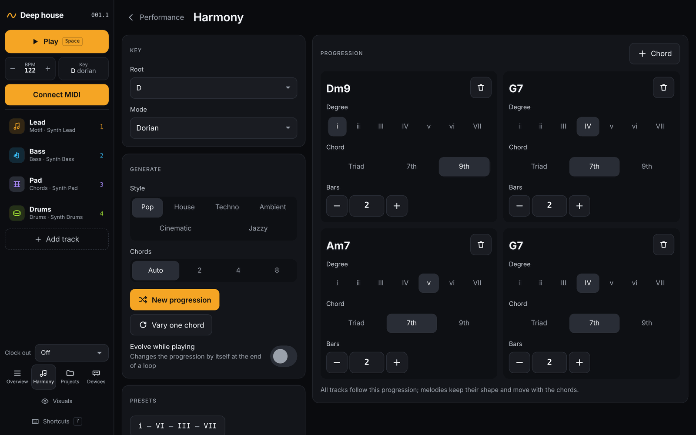

# Harmony

[← Tracks](03-tracks.md) · [Manual](README.md) · Next: [Playing together →](05-playing-together.md)

The harmony is the one thing every track follows: the key, the mode and
the chord progression. Open it with **Harmony** in the left bar, or by
clicking the key or a chord.

## Key

- **Root**: C to B.
- **Mode**: Major (Ionian), Dorian, Phrygian, Lydian, Mixolydian, Minor
  (Aeolian), Locrian, Harmonic minor, Melodic minor, Major pentatonic and
  Minor pentatonic. Pentatonic scales build chords from five notes, so some
  chords sound unusual.

## Progression

Each chord in the progression has:

- **Degree**: which chord of the key, as a roman numeral (i, ii, III…).
- **Chord**: *Triad*, *7th* or *9th*.
- **Bars**: how long it lasts (1–16).

**+ Chord** adds a chord; the trash button removes one.

Melodic tracks keep their shape and move with the chords: when the
progression moves from i to IV, a motif moves up with it.

## Generate

- **Style**: Pop, House, Techno, Ambient, Cinematic or Jazzy.
- **Chords**: how many chords, or *Auto*.
- **New progression** writes a fresh progression in that style.
- **Vary one chord** swaps a single chord.
- **Evolve while playing** changes the progression by itself at the end
  of a loop. Choose **How** (vary one chord, or a new progression) and
  **Every (loops)**.

## Presets

Common progressions in one tap: i – VI – III – VII, I – V – vi – IV,
i – iv – v – i, ii – V – I, i – VII – VI – VII and I – IV.

Next: [Playing together →](05-playing-together.md)
