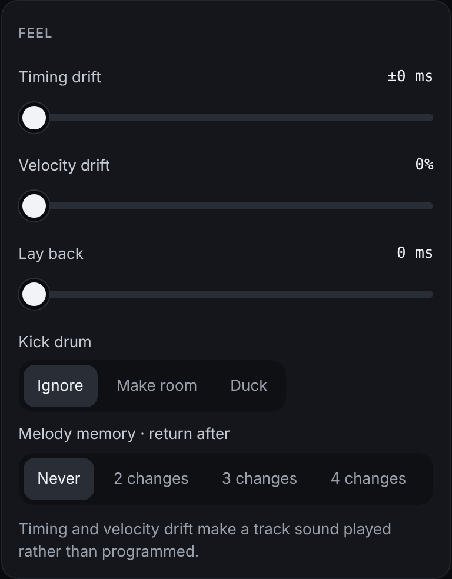
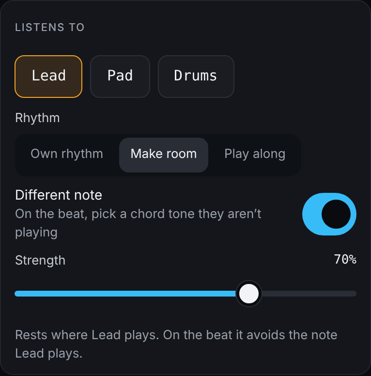
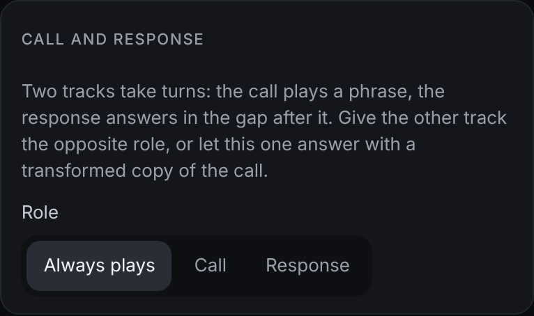

# Playing together

[← Harmony](04-harmony.md) · [Manual](README.md) · Next: [The AI ensemble →](06-ensemble.md)

Tracks can do more than play next to each other: they can sound played
by hand, make room for each other, and take turns.

## Feel

The **Feel** card is on a track's *Generator* tab.

- **Timing drift**: small random timing changes, up to ±18 ms.
- **Velocity drift**: small random velocity changes.
- **Lay back**: plays up to 25 ms behind the beat.
- **Kick drum** (bass and acid tracks only):
  - *Ignore* (default) plays as written.
  - *Make room* moves a bass note that lands on a kick to the next step.
    If that step is taken, the note is left out.
  - *Duck* plays it softer, like sidechain compression.
- **Melody memory**: after 2, 3, 4 or 6 changes, the track comes back to
  **the theme** (the pattern it started with) or to **an earlier
  variation**, then evolves again. This gives a track a recognisable hook.

## Listens to

**Listens to** lets a track react to what other tracks play on the same
step, live, and also after they mutate. The card is on the *Generator*
tab.

1. Pick the tracks to listen to.
2. Choose the **Rhythm**:
   - *Own rhythm*: the rhythm isn't affected.
   - *Make room*: rest where they play. A bass that makes room for the
     lead fills the gaps between its notes.
   - *Play along*: play together with them (a little louder) and rest in
     between.
3. **Different note** (melodic tracks): on the beat, move to a chord tone
   the others aren't playing, so two parts don't double each other.
4. **Strength** sets how strictly the rules apply.

The lane on the performance screen shows a badge such as *↔ Lead*.
Muted tracks aren't heard. The pattern view shows the track's own
pattern; the listening happens as it plays.

## Call and response

Two tracks take turns, phrase by phrase: the call plays a phrase, and the
response answers in the gap after it. The card is on the *Modulation* tab.

- **Role**: *Always plays*, *Call* or *Response*. Give the other track
  the opposite role.
- **Phrase length (bars)**: 1, 2 or 4.
- **Answer with** (response tracks): the track's own pattern, or the
  phrase of the calling track.
- **Transform**: how the answer changes the call: *Echo*, *Invert*,
  *Up a third*, *Down a fourth* or *Reverse*.

If the calling track still plays all the time, the card offers **Make
*track* the call**.

The *Conversation* template shows this in action.

Next: [The AI ensemble →](06-ensemble.md)
