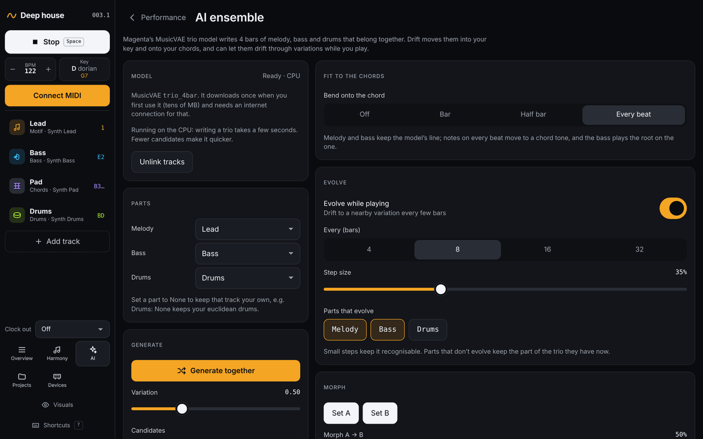
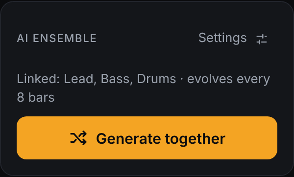

# The AI ensemble

[← Playing together](05-playing-together.md) · [Manual](README.md) · Next: [Sound and modulation →](07-sound-and-modulation.md)

The **AI** page lets one AI model write melody, bass and drums *together*,
so the parts fit: the bass leaves room for the melody and locks with the
kick. The model is Magenta's
[MusicVAE](https://magenta.tensorflow.org/music-vae) *trio*, which writes
four bars at a time. Open it with **AI** in the left bar, or press `A`.

## Quick start

1. Under **Parts**, check which tracks play the **Melody**, **Bass** and
   **Drums**. Drift fills these in by track type. Set a part to *None* to
   keep that track your own: *Drums: None* keeps your euclidean drums, for
   example.
2. Click **Load model and generate**, or press `G` anywhere in Drift. The
   first time, Drift downloads the model (tens of MB), which needs an
   internet connection. Your browser may keep it in its cache, but it can
   also download it again later.
3. Press Play. The linked tracks now play 4-bar (64-step) patterns from the
   model.

While playing, a new trio starts at the next 4-bar phrase, so nothing is
cut off. The performance screen has a small **AI ensemble** card with the
same **Generate together** button and a link to this page.

## Model

Shows whether the model is loaded and whether it runs on the **GPU**
(fast) or the **CPU** (a few seconds per trio). **Unlink tracks** stops
following the model: the tracks keep their current patterns and evolve
with their own generators again.

## Generate

- **Generate together** writes a new trio.
- **Variation** (0.1–1.5): low values are safe and repetitive, high values
  more surprising. 0.5 is a good start.
- **Candidates** (1, 4, 8 or 16): how many trios Drift writes each time.
  It scores them on groove (a kick on the one, a backbeat, steady hats,
  not too busy), a melody that moves, and a bass with some variety, and
  plays the best one. More candidates give better results but take longer,
  especially on the CPU.
- **Melody** and **Drums** (*Any*, *Sparse*, *Balanced* or *Busy*): which
  candidates you prefer. This nudges the choice; it doesn't force it.

## Fit to the chords

The model knows nothing about your chords, so Drift moves its notes into
your key and bends some of them onto the chord that plays. **Bend onto the
chord** sets which notes:

- **Off**: only moved into the key. Lines play as the model wrote them
  and may clash with your chords.
- **Bar**: the first note of each bar.
- **Half bar** (default): the start and the middle of each bar.
- **Every beat**: the most consonant, and the furthest from the model's
  line.

Except with *Off*, the bass plays the chord root on the one. Changing this
re-fits the current trio straight away, without the model. Because melody
and bass are stored relative to the key, a trio also follows when you
change the key in [Harmony](04-harmony.md).

## Evolve

- **Evolve while playing**: every **4, 8, 16 or 32 bars**, the trio
  drifts to a nearby variation.
- **Step size**: how far each step goes. Small steps keep it
  recognisable.
- **Parts that evolve**: switch a part off to keep its current pattern
  while the others keep changing. For example, keep the drums steady and
  let melody and bass wander.

Linked tracks don't mutate on their own; they follow the model. **Freeze**
a track to keep its part completely, also when you click **Generate
together**.

## Morph

1. When you like a trio, click **Set A**.
2. Generate until you like another one, then click **Set B**.
3. Slide **Morph A → B** to move between them. The points in between are
   new trios that have something of both.

## Recent trios

The last twelve trios that played. Click one to bring it back exactly as
it was. This list is kept until you reload the page. The current trio
itself is saved with the project, so after a reload it plays without the
model; click **Load model** to evolve it further.

## Tips

- If a trio is busy or flat, generate again: trios vary a lot.
- Edit a part by hand on the track's *Pattern* tab. The track is then
  frozen, so the model leaves it alone.
- The model needs the 16-step grid in 4/4.

Next: [Sound and modulation →](07-sound-and-modulation.md)
