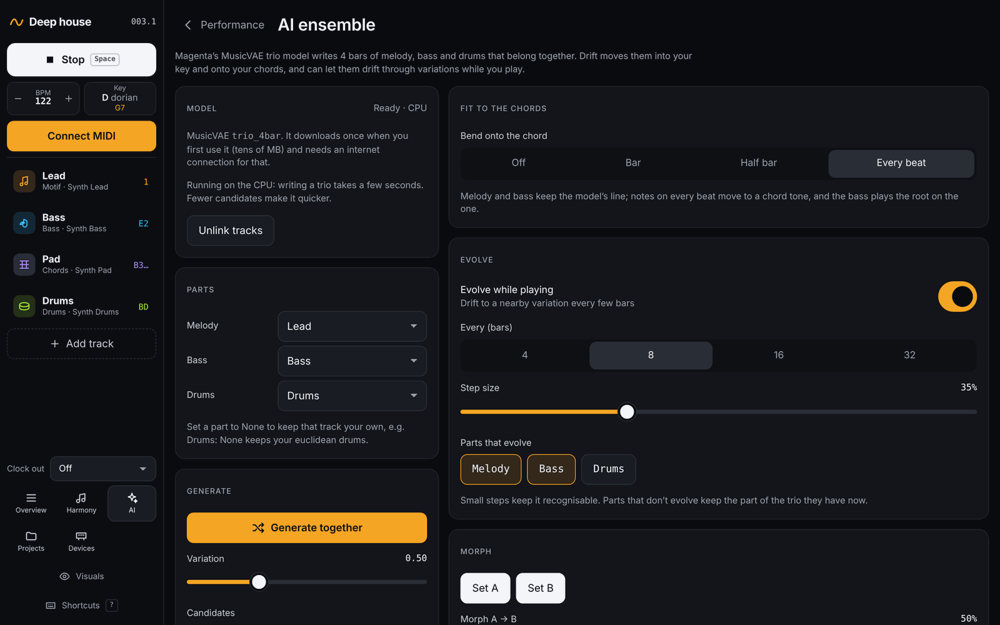
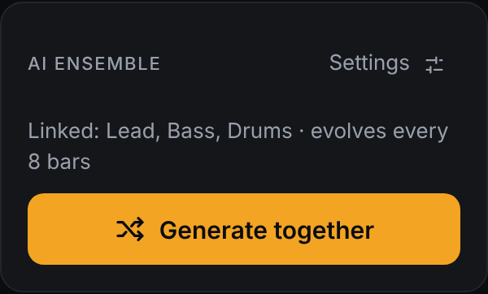

# The AI ensemble

[← Playing together](05-playing-together.md) · [Manual](README.md) · Next: [Sound and modulation →](07-sound-and-modulation.md)

On the **AI** page, Claude composes a lead melody with bass, pads and drums
*together*, on your key and chords. It writes a piece the way a musician
would: a few sections built from one motif (A, a variation A2, a contrasting
B), played in a form such as A A2 B A. While it plays, Claude writes the next
part of the piece, so the music develops instead of starting over. Open the
page with **AI** in the left bar, or press `A`.

## Quick start

1. Under **Claude**, paste your API key from
   [console.anthropic.com](https://console.anthropic.com) and click
   **Save**. Set a spend limit there too.
2. Under **Parts**, check which tracks play the **Melody** (lead),
   **Bass**, **Pads** and **Drums**. Drift fills these in by track type. Set
   a part to *None* to keep that track your own: *Drums: None* keeps your
   euclidean drums, for example.
3. Optionally describe what you want under **Style and wishes**.
4. Click **New piece**, or press `G` anywhere in Drift, and press Play.

While playing, a new piece starts at the next section, so nothing is cut
off, and the music keeps going while Claude writes. The performance screen
has a small **AI ensemble** card with **New piece**, **Develop** and a link
to this page.

## Claude

Your API key and the **Model**: *Haiku* is fast, *Sonnet* writes better
music, *Opus* is the strongest and slowest. The key is kept in this browser
only and sent only to Anthropic's API. It is never saved in the project, so
exporting or sharing a project doesn't share it. Every new piece or part is
one request on your Anthropic account.

## Compose

- **Style and wishes**: free text passed to Claude as written, e.g. *dark
  melodic techno, a lead that sings, bass on the offbeat*.
- **Section length**: 4, 8 or 16 bars. Longer sections give the lead room
  for a whole melody that builds and comes home; they take longer to write.
  Sections always last whole passes of your chord progression, so a section
  always meets the same chords.
- **Lead** and **Drums**: how busy they should be.
- **New piece** starts fresh; **Develop** writes the next part of the piece
  that plays, right away.

## Form

The piece's title and its form. The highlighted section plays now; tap
another to play it next. **Unlink tracks** stops following the piece: the
tracks keep their current patterns and evolve with their own generators
again.

## Evolve

With **Keep composing while playing** on, Claude writes the next part of the
piece during the last pass through the form, and it starts when the form
comes round. **Move on after** sets how many passes that takes: more passes
give the listener time to learn the piece. Under **Parts that change**,
switch off a part to keep it as it is, e.g. keep the drums while the lead
and bass move on.

## Fit to the chords

Claude writes for your chords, so this can stay **Off**. If you change the
chords while a piece plays, turn it on: lead and bass notes on the start of
each bar (or half bar, or beat) move to a tone of the chord that plays, and
the bass plays the root on the one. Pads always play the chord that sounds.

## Recent pieces

The pieces that played, so you can go back to one you liked. They are kept
until you reload. The piece that plays is saved with the project, so after
a reload it plays again without the API.

## Tips

- Not happy with a piece? Click **New piece**, or add a wish such as *more
  space in the lead* and try again.
- Edit a part by hand on the track's *Pattern* tab. The track is then
  frozen, so the ensemble leaves it alone.
- Without an internet connection the piece that plays keeps looping; it
  just doesn't develop.

Next: [Sound and modulation →](07-sound-and-modulation.md)
