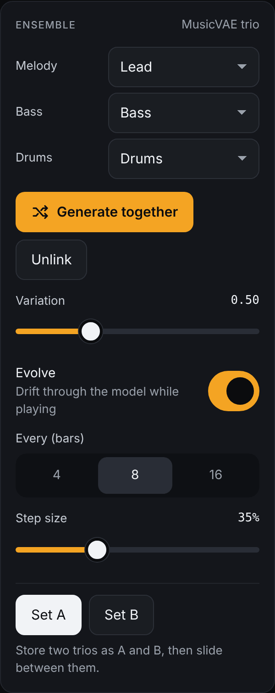

# The AI ensemble

[← Playing together](05-playing-together.md) · [Manual](README.md) · Next: [Sound and modulation →](07-sound-and-modulation.md)

The **Ensemble** card, on the right of the performance screen, lets one AI
model write melody, bass and drums *together*, so the parts fit: the bass
leaves room for the melody and locks with the kick. The model is Magenta's
[MusicVAE](https://magenta.tensorflow.org/music-vae) *trio*, which writes
four bars at a time.

## Generate a trio

1. Choose which tracks play the **Melody**, **Bass** and **Drums**. Drift
   fills these in by track type. Set a part to *None* to keep that track
   as it is. For example, *Drums: None* keeps your own euclidean drums.
2. Click **Load model and generate**. The first time, Drift downloads the
   model (tens of MB). This needs an internet connection; after that your
   browser keeps it.
3. Drift writes several trios, scores them on groove, a moving melody and
   a bass with some variety, and plays the best one. The linked tracks get
   4-bar (64-step) patterns.

**Generate together** writes a new trio. While playing, the new parts
start at the next 4-bar phrase, so nothing is cut off.

The model's notes are moved into your key. Melody and bass keep the line
the model wrote, and only their strong points (the start and the middle
of each bar) are bent onto your chords; the bass plays the root on the
one. So the trio follows your [harmony](04-harmony.md).

## Variation and evolve

- **Variation** (0.1–1.5): low values are safe and repetitive, high
  values more surprising. 0.5 is a good start.
- **Evolve**: while playing, the trio drifts to a nearby variation every
  **4, 8 or 16 bars**. **Step size** sets how far each step goes. Small
  steps keep it recognisable.

Linked tracks don't mutate on their own; they follow the model. **Freeze**
a track to keep its current part while the others evolve.

## Morph between two trios

1. When you like a trio, click **Set A**.
2. Generate until you like another one, then click **Set B**.
3. Slide **Morph A → B** to move smoothly between them. The in-between
   points are new trios that have something of both.

## Stop following the model

**Unlink** keeps the current patterns, and the tracks evolve with their
own generators again. Your trio is saved with the project, so after a
reload it plays without the model. Click **Load model** to continue
evolving.

## Tips

- If the result is busy or flat, generate again: trios vary a lot.
- Edit a part by hand on the track's *Pattern* tab. The track is then
  frozen, so the model leaves it alone.
- The model needs the 16-step grid in 4/4.

Next: [Sound and modulation →](07-sound-and-modulation.md)
