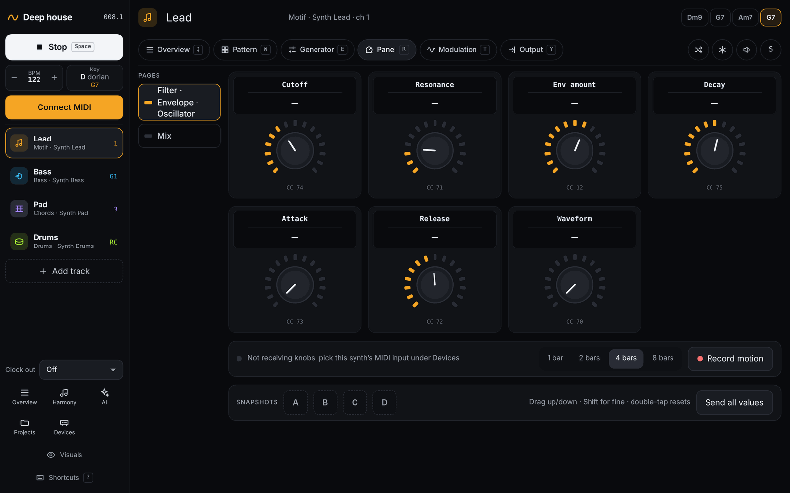
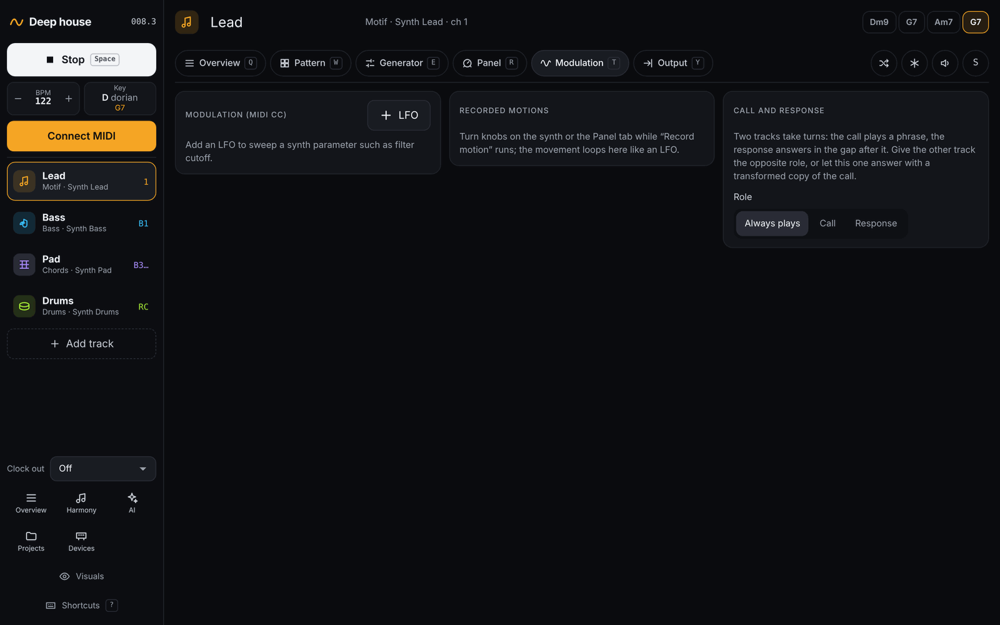

# Sound and modulation

[← The AI ensemble](06-ensemble.md) · [Manual](README.md) · Next: [Devices →](08-devices.md)

Drift can also turn your synth's knobs: from an on-screen panel, with
LFOs, or by looping knob movements you record.

All of this uses the device's **instrument definition** (CC map), which
you choose under [Devices](08-devices.md). Without one, the panel stays
empty; LFOs can still send any CC number.

## Panel

The *Panel* tab shows the synth's knobs, grouped in pages of eight.

- **Drag** a knob up or down. Hold Shift for fine control. The mouse
  wheel also works.
- **Double-tap** a knob to reset it.
- With a knob focused: arrow keys, PageUp/PageDown (±10), and Home/End.
- The ring around a knob also shows the range of an LFO or motion on it.
- **Snapshots A–D**: tap an empty slot to store all knob values, and tap
  a filled one to recall them. Shift+tap overwrites.
- **Send all values** sends every knob to the synth again, for example
  after switching sounds.

## Record motion

Turn knobs on the panel, or on the synth itself, and Drift loops the
movement like an LFO. The recorder is at the bottom of the *Panel* tab, so
it needs an instrument definition with knobs.

1. To record knobs turned on the synth, Drift has to receive them: set
   **Knobs in (MIDI input)** for the device under
   [Devices](08-devices.md). For the on-screen knobs this isn't needed.
2. Press Play. Choose a length (**1 bar**, **2 bars**, **4 bars** or
   **8 bars**; 4 by default) and click **Record motion**.
3. Recording starts on the next bar. Turn the knobs.

Recorded motions appear in the **Recorded motions** card on the
*Modulation* tab, where you can switch them on or off, or remove them. A
new recording on the same knob replaces the old one.

## LFOs

The **Modulation (MIDI CC)** card on the *Modulation* tab adds software
LFOs that send a CC, such as a slow filter sweep.

- **+ LFO** adds one, aimed at the filter cutoff if the synth has one.
- **Parameter**: the knob to move, from the CC map. Without a map, set
  the **CC number** yourself.
- **Shape**: Sine, Tri, Saw, Square or S&H (random steps).
- **Cycle (bars)**: 1, 2, 4, 8 or 16.
- **Min** and **Max**: the range (0–127).

While you turn a knob by hand, Drift's LFO and motions on that knob wait.

Next: [Devices →](08-devices.md)
