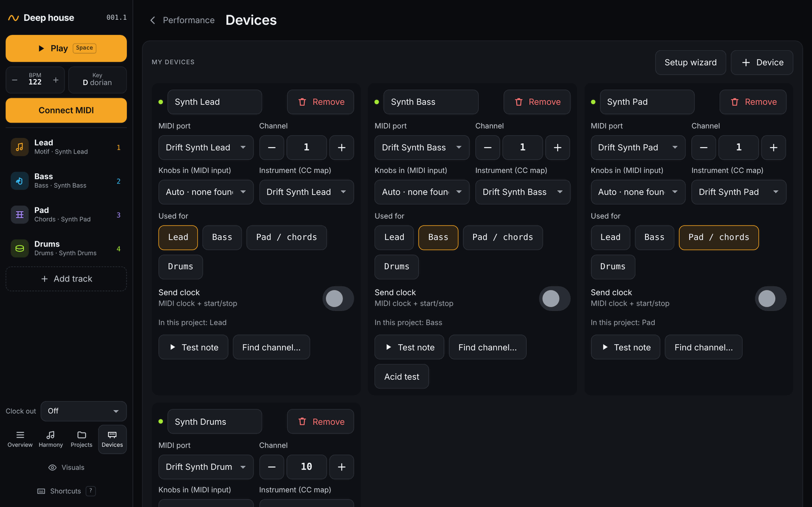

# Devices

[← Sound and modulation](07-sound-and-modulation.md) · [Manual](README.md) · Next: [Projects and templates →](09-projects.md)

Your hardware setup lives under **Devices** in the left bar. It is shared
by all projects on this computer: tracks pick a device, and templates pick
one by role, so switching templates keeps your setup.

## My devices

**Setup wizard** reopens the quick setup from
[Getting started](01-getting-started.md). **+ Device** adds a device by
hand. Each device has:

- **MIDI port** and **Channel** (1–16). The dot shows whether the port is
  connected.
- **Knobs in (MIDI input)**: where Drift listens for this synth's knobs,
  for [recording motions](07-sound-and-modulation.md). *Auto* guesses the
  input with the same name.
- **Instrument (CC map)**: which synth this is, so Drift knows its knobs
  and drum notes.
- **Used for**: the roles it plays (Lead, Bass, Pad / chords, Drums).
  New tracks and templates pick devices by role.
- **Send clock**: MIDI clock and start/stop, so the device follows
  Drift's tempo. The **Clock out** menu in the left bar picks a single
  clock device quickly.
- **Test note** plays a note.
- **Find channel…** steps through channels 1–16 with a test note until
  you hear it, then click **That one!**.
- **Acid test** (bass devices and 303-style synths) plays plain, accent
  and slide notes, to check accent and slide.

**Remove** deletes a device. Tracks that used it move to another device
with the same role.

## The built-in Drift Synth

When you have no hardware, or in Safari, choose these ports. They are
sounds built into Drift and play through your speakers:

| Port | Sound |
| --- | --- |
| Drift Synth Lead | Polyphonic saw synth with a resonant filter |
| Drift Synth Bass | 303-style mono bass. Overlapping notes slide; loud notes are accents |
| Drift Synth Pad | Wide detuned pad with chorus |
| Drift Synth Drums | Analog-style kit (808, 909 and electro sounds) |

They react to the knobs on the [Panel](07-sound-and-modulation.md) (cutoff,
resonance, envelope and so on) and share reverb and delay. They ignore
the MIDI channel and clock.

## Instrument definitions

Instrument definitions tell Drift which CC moves which knob, and which
note triggers which drum.

- **midi.guide library**: click **Browse midi.guide** to search CC maps
  for hundreds of synths, from [midi.guide](https://midi.guide) by Pencil
  Research (CC BY-SA 4.0). **Import** adds one.
- **Installed definitions** lists what you have. Built-in ones can't be
  deleted.
- **Import from file**: choose a midi.guide CSV, optionally with its
  `.triggers.csv` for drum notes.

## MIDI in monitor

The **MIDI in monitor** shows every message that comes in, with the port,
channel and which tracks it reaches. Turn a knob on a synth to check
that Drift hears it.

## Appearance

Pick a **Theme**: *Studio* (the default; dark and calm), *Hi-Fi*,
*Modular*, *Tide* or *Phosphor*. `Shift+T` cycles through them. The
choice is saved in this browser.

Next: [Projects and templates →](09-projects.md)
