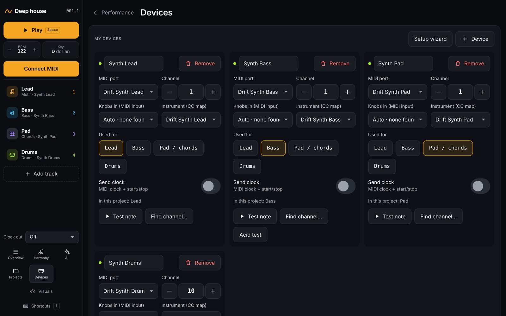

# Devices

[← Sound and modulation](07-sound-and-modulation.md) · [Manual](README.md) · Next: [Projects and templates →](09-projects.md)

Your hardware setup lives under **Devices** in the left bar. It is shared
by all projects on this computer: tracks pick a device, and templates pick
one by role, so switching templates keeps your setup.

## My devices

**Setup wizard** reopens the quick setup from
[Getting started](01-getting-started.md). **+ Device** adds a device by
hand. Each device has:

- **MIDI port** and **Channel** (1–16). The dot shows whether the port is
  connected.
- **Knobs in (MIDI input)**: where Drift listens for this synth's knobs,
  for [recording motions](07-sound-and-modulation.md). *Auto* guesses the
  input with the same name; *Off* ignores incoming knobs.
- **Instrument (CC map)**: which synth this is, so Drift knows its knobs
  and drum notes.
- **Used for**: the roles it plays (Lead, Bass, Pad / chords, Drums).
  New tracks and templates pick devices by role.
- **Send clock**: MIDI clock and start/stop, so the device follows
  Drift's tempo. Several devices can have it on. The **Clock out** menu in
  the left bar quickly picks a single clock device.
- **Test note** plays three notes: C–E–G on a synth, or kick, snare and
  hat on a drum machine.
- **Find channel…** steps through channels 1–16 with a test note until
  you hear it, then click **That one!**.
- **Acid test** (bass devices and 303-style synths) plays plain, accent
  and slide notes, to check accent and slide.

**Remove** deletes a device. Tracks that used it move to another device
with the same role.

## The built-in Drift Synth

When you have no hardware, or in Safari, choose these ports. They are
sounds built into Drift and play through your speakers:

| Port | Sound |
| --- | --- |
| Drift Synth Lead | Polyphonic saw synth with a resonant filter |
| Drift Synth Bass | 303-style mono bass. Overlapping notes slide; loud notes are accents |
| Drift Synth Pad | Wide detuned pad with chorus |
| Drift Synth Drums | Analog-style kit (808, 909 and electro sounds), or one of five sampled kits |
| Drift Synth Juno | Six-voice Juno-60-style polysynth with chorus, for pads, chords and leads |
| Drift Synth Mono | Minimoog / SH-101-style mono synth: round basses without the acid squelch, and mono leads |
| Drift Synth Piano | Sampled piano: Concert Grand, Steinway, Studio Grand or Wurlitzer |

They react to the knobs on the [Panel](07-sound-and-modulation.md) (cutoff,
resonance, envelope and so on) and share reverb and delay. They ignore
the MIDI channel and clock.

**Drift Synth Juno** has the whole Juno-60 panel, in six sections:

- **Filter**: cutoff, resonance, envelope amount, LFO to filter, key
  follow and the high-pass (HPF; fully left is off).
- **Envelope**: one ADSR for both filter and level.
- **Oscillator**: range (16′ / 8′ / 4′), LFO to pitch (vibrato), PWM and
  its source (LFO, manual or envelope).
- **Mixer**: faders for pulse, saw, sub and noise.
- **LFO**: rate and delay.
- **Amp · Effects**: chorus (off, I, II, I+II), VCA level and the reverb
  and delay sends.

A seventh note takes over the voice that was released longest ago, or
else the oldest held note. The sound runs in its own audio thread
(AudioWorklet), loaded the first time you use it.

**Drift Synth Mono** is a monophonic synth for bass (and leads), in the
spirit of a Minimoog or SH-101:

- **Oscillator · Mixer**: two oscillators (saw, pulse or triangle; the
  second with its own octave and detune), pulse width, a sine sub one
  octave down and noise.
- **Filter**: a driven 24 dB ladder with its own envelope, key follow,
  velocity to filter (*Vel to filter*) and accent (notes with velocity
  100 or more get louder and brighter).
- **Amp**: ADSR and level.
- **Pitch · LFO**: glide, a pitch envelope (each note starts higher and
  drops, for punchy sub and 808 basses), and an LFO to filter and pitch.

The newest held note plays. Overlapping notes slide when glide is up and
don't restart the envelopes; releasing the top note goes back to the one
still held.

Both the Juno and the Mono come with **presets**, such as *Round Moog*,
*101 Pluck*, *Deep Sub*, *808 Boom* and *Reese* on the Mono. Pick one at
the bottom of the [Panel](07-sound-and-modulation.md).

### Sampled drum kits

On Drift Synth Drums, the **Samples** knob (Kit page) swaps the synthesized
kit for recorded drums:

| Kit | Sound |
| --- | --- |
| Acoustic | Pearl kit with Sabian cymbals, five velocity layers |
| Vintage | Ludwig kit with a porkpie snare and Zildjian cymbals |
| Jazz brushes | Brushes; note 40 plays a brush sweep |
| Deep house | TR-808, hit by hit, with congas and maracas |
| 80s Linn | LinnDrum LM-2 |

A kit downloads the first time you pick it (0.5–4 MB) and is then kept by
the browser, so it also works offline. Until it is ready, the synthesized
kit keeps playing. Turn the knob back to **Off** for the synth kit.

The tune, decay and level knobs work on the samples too (decay can only
shorten a hit). A drum a kit has no sample for, such as a clap in the
brushes kit, is played by the synth kit. Sources and licenses are in
[public/kits/ATTRIBUTION.md](../public/kits/ATTRIBUTION.md).

### Drift Synth Piano

A sampled piano with four packs, picked with the **Pack** switch:

| Pack | Sound |
| --- | --- |
| Concert Grand | Yamaha C5 grand (Salamander), full and even |
| Steinway | Steinway grand, warm and round |
| Studio Grand | Yamaha C3 grand, close mics, bright |
| Wurlitzer | Wurlitzer EP200 electric piano |

Each pack has a soft and a hard velocity layer and takes 1–4 MB. Like the
drum kits, a pack downloads the first time you use it and is then kept by
the browser, so it also works offline. Until it is ready, a soft synth tone
plays in its place.

The other knobs: **Tone** (a low-pass; fully right is open), **Dynamics**
(how much louder hard notes are), **Decay** (fully right lets notes ring
out; lower shortens them, even while held), **Release** (how long a note
rings after it ends), and level, reverb and delay. The presets (such as
*Felt Piano*, *Ballad Hall* and *Lo-fi Keys*) combine a pack with these.

Notes ring out like a real piano for a few seconds at most; there is no
sustain pedal. Sources and licenses are in
[public/pianos/ATTRIBUTION.md](../public/pianos/ATTRIBUTION.md).

## Instrument definitions

Instrument definitions tell Drift which CC moves which knob, and which
note triggers which drum.

- **midi.guide library**: click **Browse midi.guide** to search CC maps
  for hundreds of synths, from [midi.guide](https://midi.guide) by Pencil
  Research (CC BY-SA 4.0). Search by name; **Import** adds one, and
  **Update** refreshes one you already have.
- **Installed definitions** lists what you have. Built-in ones can't be
  deleted.
- **Import from file**: choose a midi.guide CSV, optionally with its
  `.triggers.csv` for drum notes.

## MIDI in monitor

The **MIDI in monitor** shows every message that comes in, with the port,
channel and which tracks it reaches. Turn a knob on a synth to check
that Drift hears it.

## Appearance

Pick a **Theme**: *Studio* (the default; dark and calm), *Hi-Fi*,
*Modular*, *Tide* or *Phosphor*. `Shift+T` cycles through them. The
choice is saved in this browser.

Next: [Projects and templates →](09-projects.md)
