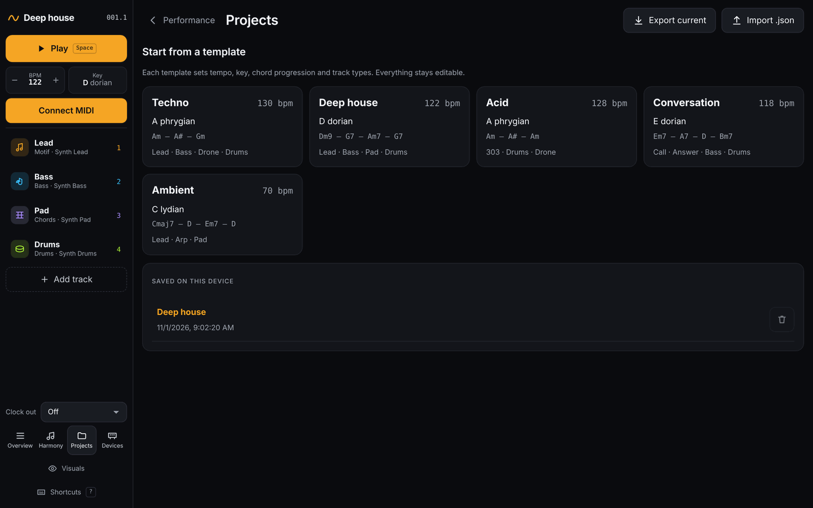

# Projects and templates

[← Devices](08-devices.md) · [Manual](README.md) · Next: [Keyboard shortcuts →](10-shortcuts.md)

Open **Projects** in the left bar, or click the project name at the top.

## Templates

Each template sets the tempo, key, chord progression and tracks.
Everything stays editable.

| Template | Tempo and key | Tracks |
| --- | --- | --- |
| **Techno** | 130 bpm, A Phrygian | Lead, Bass, Drone, Drums |
| **Deep house** | 122 bpm, D Dorian, 7th and 9th chords | Lead, offbeat Bass, pulsing Pad, Drums |
| **Acid** | 128 bpm, A Phrygian | 303 line with cutoff and env-mod LFOs, Drums with ratchets and conditions, Drone |
| **Conversation** | 118 bpm, E Dorian, evolving harmony | Two motifs in call and response, Bass, Drums |
| **Ambient** | 70 bpm, C Lydian | Slow lead, Arpeggio, sustained Pad |

Templates use your [devices](08-devices.md) by role, so they play on your
synths straight away.

## Saved projects

Projects save automatically while you work, in this browser. **Saved on
this device** lists them: tap one to open it. You can delete any project
except the one that is open.

## Export and import

- **Export current** downloads the project as a `.drift.json` file, to
  back it up or move it to another computer.
- **Import .json** opens such a file.

Your devices aren't part of a project; they belong to the computer.

Next: [Keyboard shortcuts →](10-shortcuts.md)
