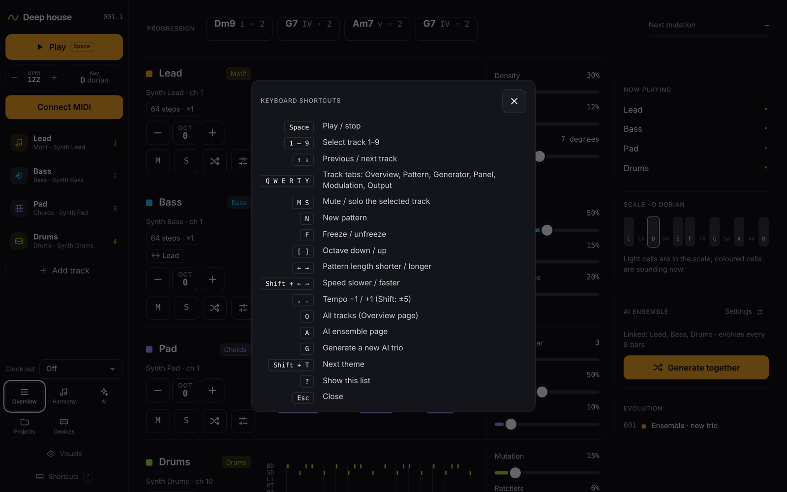

# Keyboard shortcuts

[← Projects and templates](09-projects.md) · [Manual](README.md) · Next: [Development →](11-development.md)

Press `?` in Drift to see this list.

| Key | Action |
| --- | --- |
| `Space` | Play / stop |
| `1`–`9` | Select a track |
| `↑` `↓` | Previous / next track |
| `Q` `W` `E` `R` `T` `Y` | Track tabs: Overview, Pattern, Generator, Panel, Modulation, Output |
| `M` / `S` | Mute / solo the selected track |
| `N` | New pattern |
| `F` | Freeze / unfreeze |
| `[` `]` | Octave down / up |
| `←` `→` | Pattern length (8, 16, 32, 64 steps) |
| `Shift+←` `Shift+→` | Speed slower / faster |
| `,` `.` | Tempo −1 / +1 (with Shift: ±5) |
| `O` | Overview (the performance screen) |
| `A` | AI page |
| `G` | Generate a new AI trio |
| `Shift+T` | Next theme |
| `?` | Shortcut list |
| `Esc` | Close the shortcut list |

Track keys work once a track is selected. Shortcuts are ignored while you
type in a text field. On a focused knob or slider, the arrow keys move
that control instead.

The visuals window has its own keys; see
[The performance screen](02-performance.md#visuals).

Next: [Development →](11-development.md)
